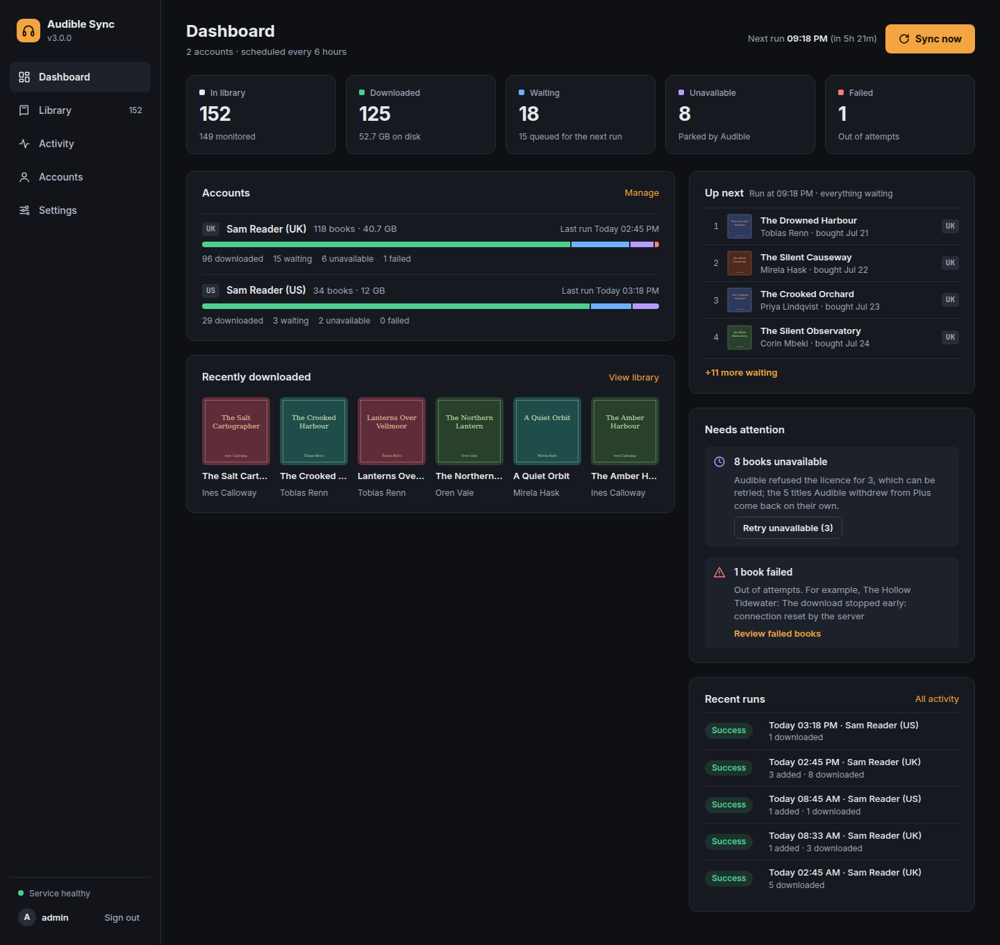

# Audible Sync

A python app that will fetch your library from audible, download the books and convert them to DRM free M4B or Ogg Opus files.

It runs as a background service: on a schedule (every six hours by default) it syncs the latest purchases from your audible library to the app database and downloads whatever is waiting. A web app shows what it is doing - the book being downloaded, your library, the run history and the service log - and is where you add accounts, pick which books to download and change the settings. Served over https, it can be installed on a phone or a computer. Underneath is an HTTP API for scripts and other applications, which can also search the Audible catalogue and read a book's or a series' details from it; a one-shot command line run is still there too.

It records the download status of each book so will only fetch the missing books. A book that keeps failing is retried up to `max-attempts` times and then left alone, with the reason recorded, rather than re-downloaded on every run forever.



## Disclaimer

This app DOES NOT crack DRM. If that's what you're after, look elsewhere. 

What this app does do is decrypt the audiobooks that you have access to in your Audible library. It can only de-drm your books, no one else's.

The purpose of this app is to allow the user more control over how they consume the books that they've paid for. I will never be adding any features to download books that are not in your library so please don't ask.

## Quick start

Copy [`compose.yml`](compose.yml) to the folder of your choice, update its volume mounts to match where you want files to be stored, and start the service:

```
docker compose up -d
```

The web app's first password is printed in the log, once:

```
docker compose logs audible-sync | grep "Web app sign-in"
```

Open `http://localhost:8080`, sign in as `admin` with that password, and go to **Accounts → Add account**. You get a five-letter code to enter at `amazon.co.uk/code` (your marketplace's) on any device; the app never sees your Amazon password. When it says Connected, press **Sync now**; after that the service syncs every six hours, and once a day re-reads every book's details from Audible (**Refresh all from Audible** does it at any time, and `audible-sync --full` from the command line).

## Documentation

 - [Installation](docs/installation.md): Docker in full, backups, a forgotten password or API token, running without Docker, installing the web app, and running behind a reverse proxy
 - [Accounts](docs/accounts.md): signing in, several marketplaces, and what to do if Audible refuses every download
 - [Configuration](docs/configuration.md): every setting, file naming templates, audio formats and environment variables
 - [API](docs/api.md): the HTTP API for scripts, the catalogue search, and a ready-made request collection
 - [Contributing](CONTRIBUTING.md): developing the web app

## Todo

Done: library sync, download and decryption to M4B or Ogg Opus with PDF, cover art, chapters and metadata; a background service with an API; several Audible accounts; and a web app to run it all from. What is left is in [`todo.md`](todo.md).
